# Student Name: Mohd Montaser Islam

# Option A – AWS Application Load Balancer

## Architecture Design

### Architectural Overview

The architecture is deployed inside a custom Amazon VPC spanning two distinct Availability Zones. Public-facing traffic enters through an Application Load Balancer (ALB) residing in public subnets across both AZs. The ALB distributes incoming requests to two backend Amazon EC2 web server instances, each placed in a separate Availability Zone and protected by dedicated security groups.

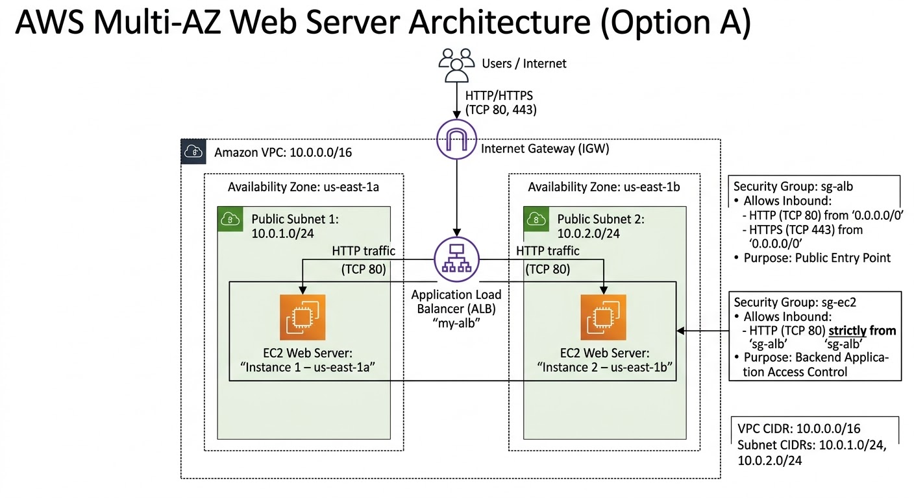

---

### Network & Infrastructure Specifications

- VPC: Custom VPC (10.0.0.0/16) configured with an Internet Gateway (IGW).
- Subnets:
  - Public Subnet 1: 10.0.1.0/24 (Availability Zone: us-east-1a)
  - Public Subnet 2: 10.0.2.0/24 (Availability Zone: us-east-1b)
- Security Groups:
  - ALB Security Group (sg-alb): Allows inbound HTTP (TCP 80) and HTTPS (TCP 443) from anywhere (0.0.0.0/0).
  - EC2 / Target Security Group (sg-ec2): Allows inbound HTTP (TCP 80) strictly from the ALB Security Group (sg-alb), blocking direct user access.

### Component Roles

- Internet Gateway (IGW): Enables internet connectivity to and from the VPC.
- Application Load Balancer (ALB): Acts as the single entry point, distributing client requests across target instances.
- Target Group: Routes requests to registered EC2 instances and performs active health monitoring.
- EC2 Instances: Compute nodes running the web server application within isolated AZ subnets.

---

## Problem 2

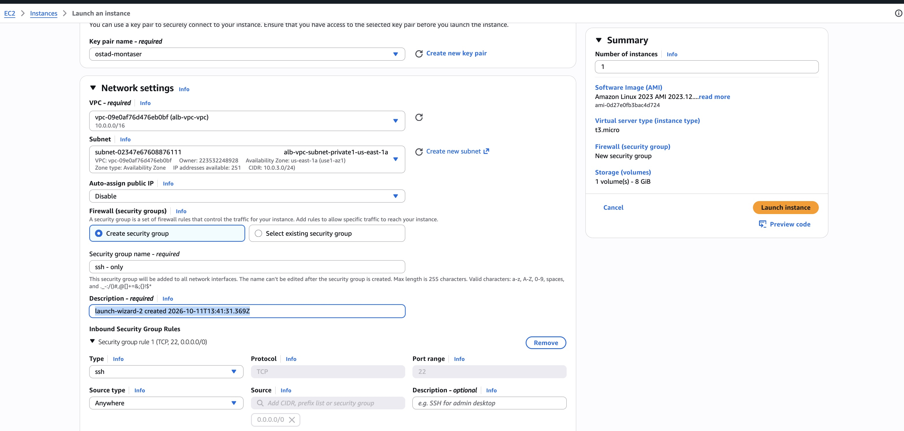

Two EC2 instances are launched in separate Availability Zones (us-east-1a and us-east-1b). A bootstrap User Data script configures a lightweight Node.js/Python web server on startup.

- EC2 User Data Script: located in the `config` folder as `user-data.sh`.

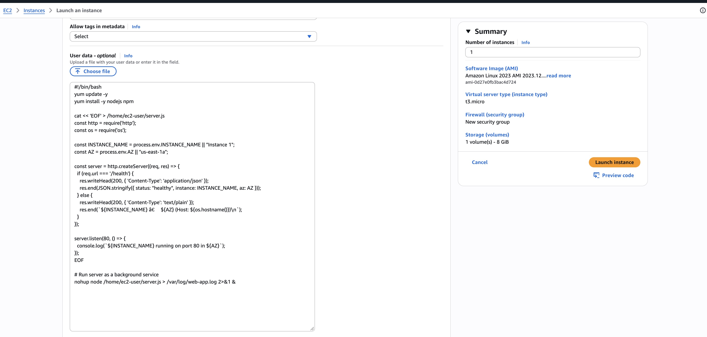

- Security Verification: Because the EC2 security group only allows ingress on port 80 sourced from `sg-alb`, attempting to access the EC2 public IP directly from a user browser or local machine will time out.

---

## Problem 3

### Configure the Load Balancer

* Target group creation

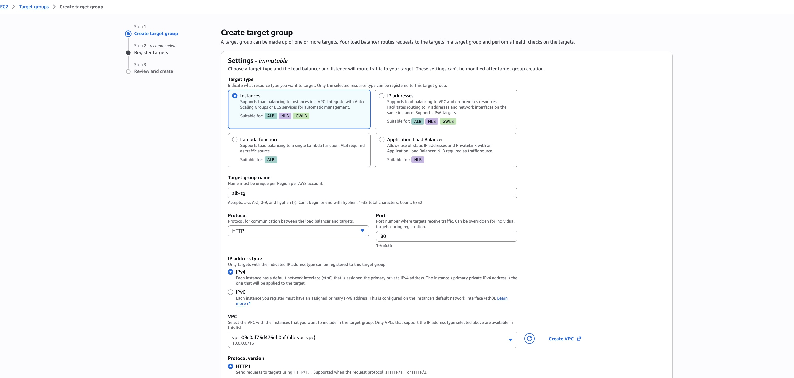
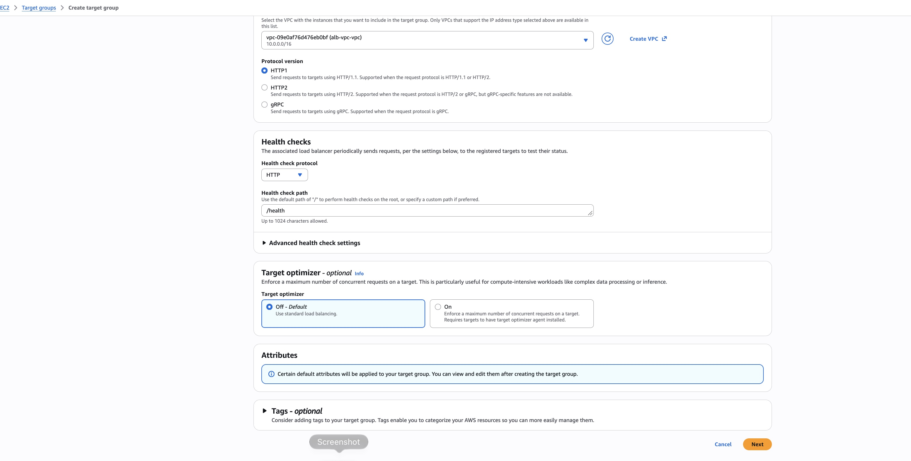
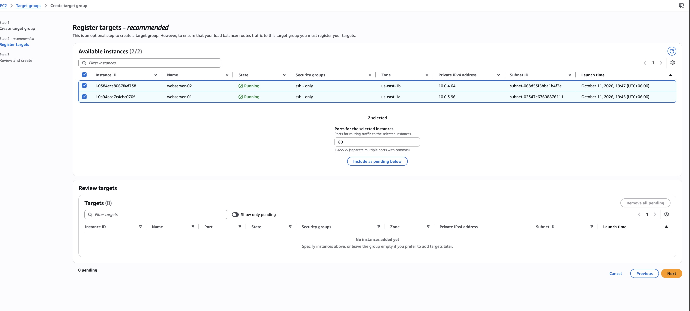
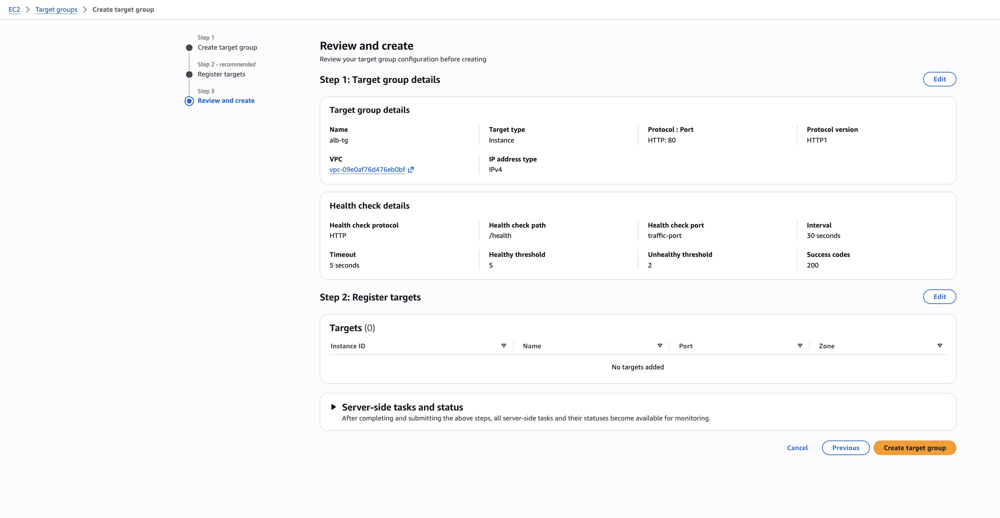

An Internet-facing Application Load Balancer (`alb-ostad`) is provisioned across both public subnets. An HTTP listener on port 80 forwards incoming traffic to a Target Group containing both EC2 instances.

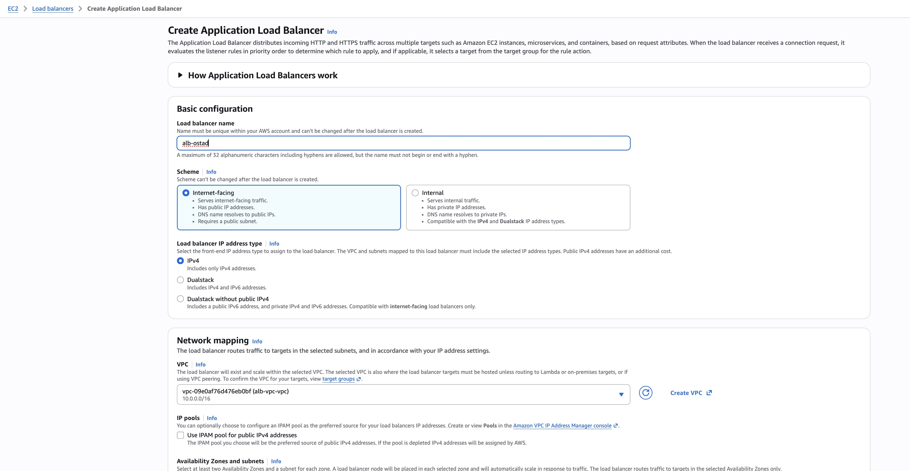
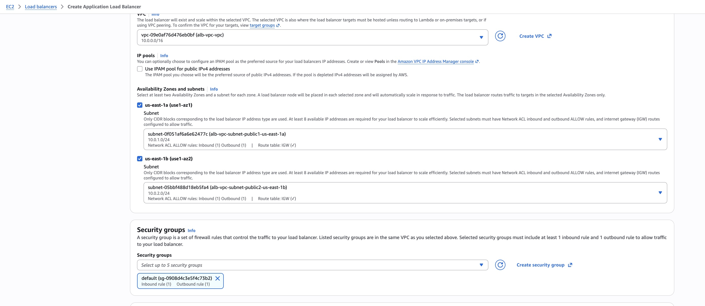
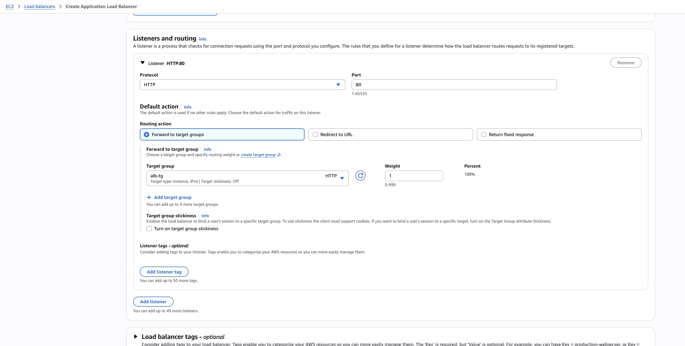

### Request Verification (T2 Test Script)

Sending 10 consecutive requests via `curl` to the ALB DNS name using the script in `./config/check-alb.sh`.

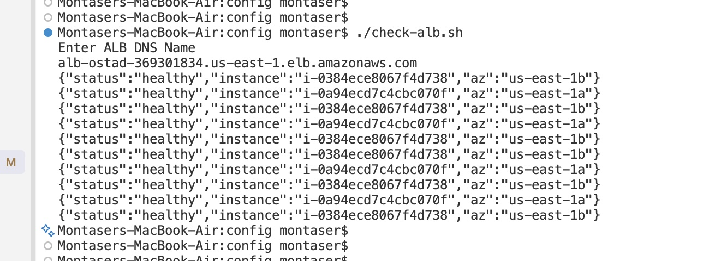

---

## ALB Access Logs and CloudWatch Metrics

To monitor traffic patterns, debug requests, and track target health in real time, enable ALB access logs (stored in Amazon S3) and view CloudWatch metrics.


### Enable ALB Access Logs

Access logs capture detailed information about requests sent to your Application Load Balancer.

#### Create an S3 Bucket

1. Open the Amazon S3 Console and click Create bucket.
2. Provide a unique bucket name (e.g., my-alb-access-logs-bucket-2026).
3. Ensure the region matches your ALB deployment region.

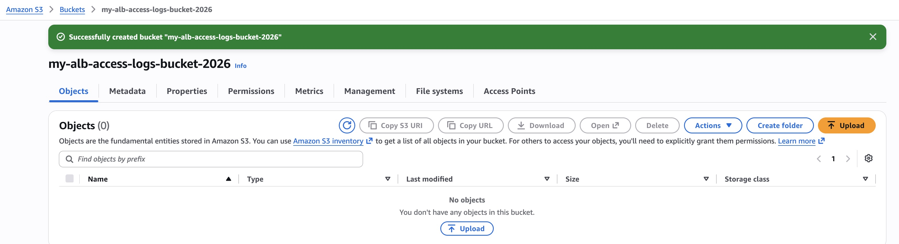

#### Enable Logging on the ALB

1. Navigate to **EC2 Console > Load Balancers**.
2. Select your Application Load Balancer.
3. In the bottom detail pane, click the Attributes tab, then click Edit.
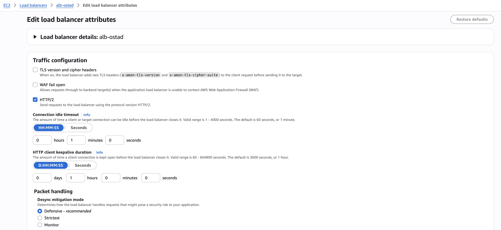


4. Check the box for Access logs.
5. Enter your S3 bucket name (and optional prefix).
6. Click Save changes.
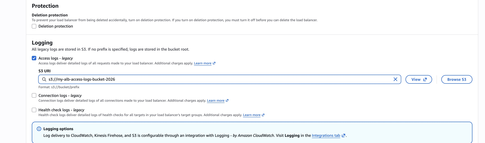

> **Note:** Ensure your S3 bucket policy allows the AWS ELB service account for your region to write log objects.

### View ALB and Target Metrics in CloudWatch

AWS automatically publishes metrics for your Application Load Balancer and Target Groups to CloudWatch without requiring manual agent installation.

1. Open the CloudWatch Console.
2. In the left navigation menu, click **Metrics > All metrics**.
3. Select the App/Net.LB namespace, then choose Per Target Group Metrics.
4. Monitor these essential metrics:
   - `RequestCount`: Total number of requests processed by the load balancer.
   - `HTTPCode_Target_2XX_Count`: Number of successful responses returned by backend instances.
   - `UnHealthyHostCount`: Number of instances currently failing health checks.
   - `HealthyHostCount`: Number of active, healthy instances in rotation.
  
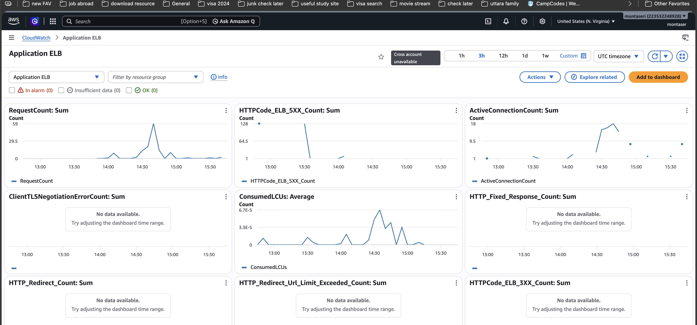  

### Bash Testing Script

To test load balancer distribution, use the script in [`./config/check-alb.sh`](./config/check-alb.sh). It sends 10 requests and prints each response on its own line:

```bash
echo "Enter ALB DNS Name"
read ALB_DNS

for i in {1..10}; do
  curl -s "http://$ALB_DNS/health"
  echo
done
```

## Problem 4

### Implement Proper Health Checks

Target Group Health Check Configuration & Justifications:

- Protocol / Path (`/health`): A dedicated lightweight endpoint that returns a `200 OK` JSON response without executing heavy computations or database calls.
- Interval (10s / default 30s): The time between health check requests. Set shorter during labs for rapid state transition validation.
- Timeout (5s): The maximum time to wait for a response from an instance before marking the check as failed.
- Healthy Threshold (2): The number of consecutive successful health checks required before an unhealthy instance is marked healthy and returned to rotation.
- Unhealthy Threshold (2): The number of consecutive failed health checks required before an instance is taken out of rotation.

### Active vs. Passive Health Checks

- Active Health Checks: Proactive background probes sent by the load balancer at regular intervals (used by AWS ALB).
- Passive Health Checks: Monitoring actual client traffic and error rates to determine instance health on the fly.
- Selected Implementation: AWS ALB exclusively uses active health checks via its configured Target Group settings.

---

## Problem 5

### Failure Testing and Proof of Work

| Test ID | Action Taken | Expected Outcome |
| --- | --- | --- |
| T1 – Health Status | Navigate to EC2 Console → Target Groups → Targets tab. | 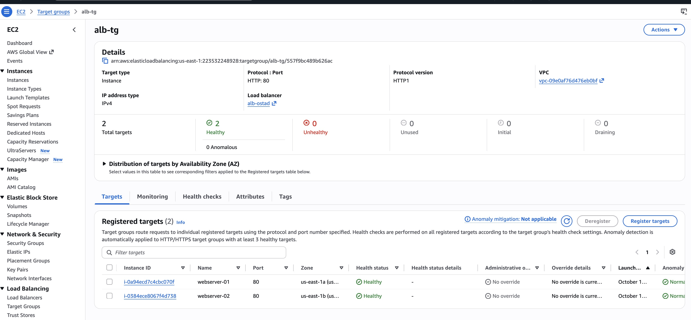 |
| T2 – Load Distribution | Execute loop of 10 curl requests against the ALB DNS endpoint. | 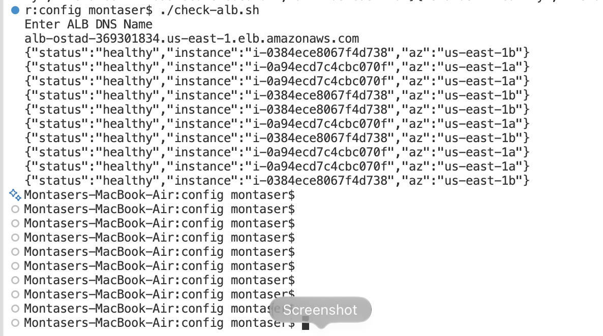 |
| T3 – Browser Test | Open the ALB DNS URL in a browser and hit refresh multiple times. | 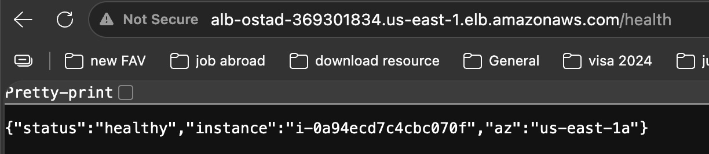  |
| T4 – AZ Failure | Stop the EC2 instance in us-east-1a (`aws ec2 stop-instances ...`), then send requests. | 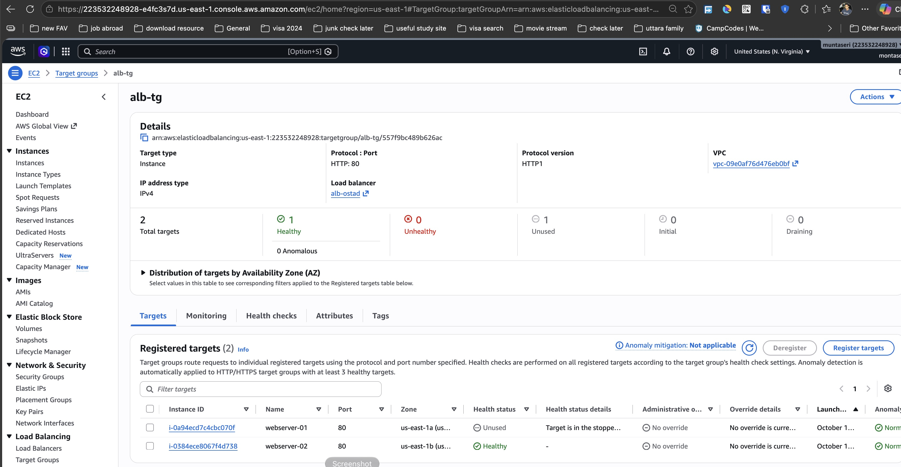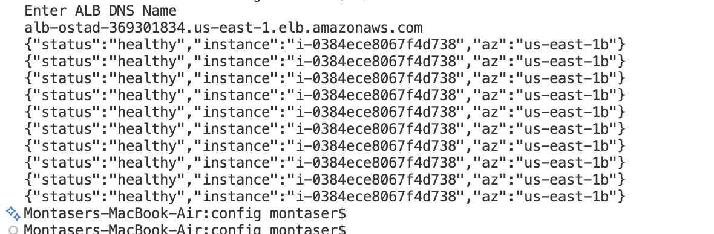 |
| T5 – Recovery | Start the us-east-1a instance again (`aws ec2 start-instances ...`). | 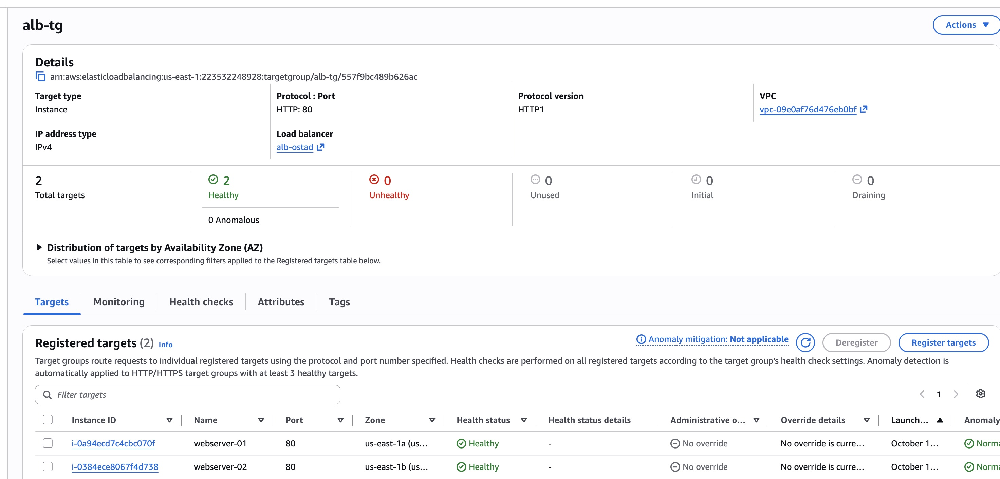 |
| T6 – Logs / Monitoring | Inspect ALB Access Logs in Amazon S3 or CloudWatch Target metrics (`RequestCount`, `HTTPCode_Target_2XX_Count`). |   
 

---

## Problem 6

### AWS ALB vs. NGINX

AWS ALB is a fully managed cloud service that offers seamless scaling, native integration with AWS IAM, security groups, and certificate management (ACM), eliminating underlying OS maintenance. However, it incurs hourly charges and creates cloud vendor lock-in. NGINX provides immense flexibility, zero licensing costs for self-hosted environments, and deep rule customization, but requires manual provisioning for high availability, patching, and scaling.

### Handling Load Balancer Single Points of Failure (SPOF)

If the ALB itself failed, ingress traffic would be completely blocked. In a real production architecture, this single point of failure is mitigated by deploying the ALB across multiple Availability Zones with built-in AWS elastic scaling, and fronting it with Amazon Route 53 DNS Failover or an AWS Network Load Balancer (NLB) for multi-region or multi-tier redundancy.

### Troubleshooting Challenge

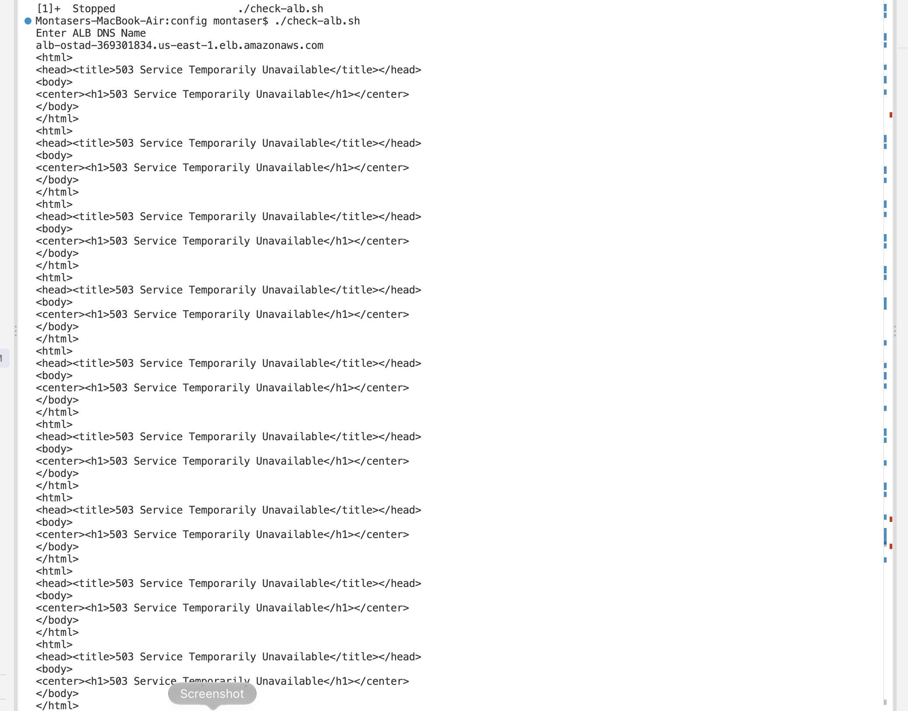
A notable challenge encountered during setup was a `503 Service Temporarily Unavailable ` error when testing requests through the ALB. Inspection revealed that the EC2 security group (`sg-ec2`) was missing an inbound rule allowing HTTP traffic from the ALB security group (`sg-alb`). Resolving this rule allowed the ALB health checks and user traffic to successfully reach the backend web servers.
